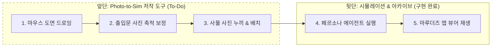
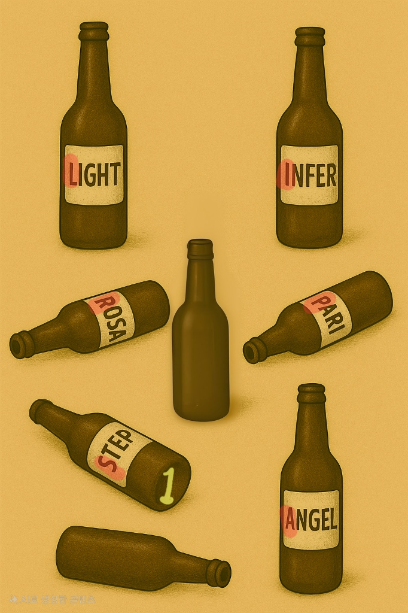
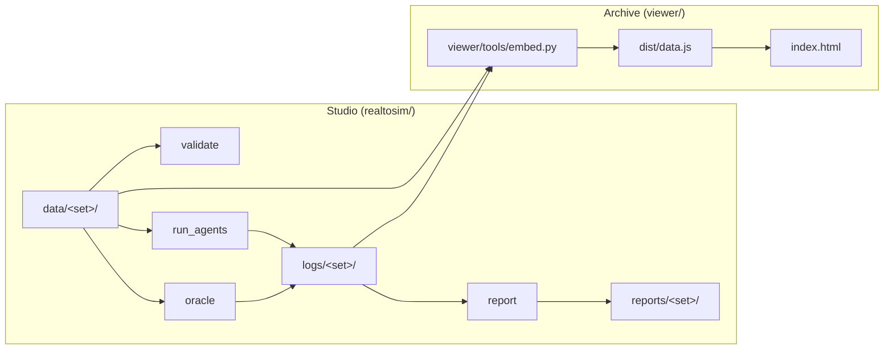

<!-- 2026-11-05 변경 사유: GitHub Actions(CI + Pages) 배포 전환을 README에 반영. -->
<!-- 2026-11-07 변경 사유: 앞단 Photo-to-Sim 비전, 마루더즈 맵 로드맵, docs/photo-to-sim-vision.md 링크 추가. -->
# Real-to-Sim Archive  [](https://github.com/erdoslibrary/meta_hackathon/actions/workflows/pages.yml)

[English](README.md) | **한국어**

> 로봇 분야의 real-to-sim 방식을 실제 건물에 놓인 퍼즐에 적용해 본 작은 실험입니다.

[](https://youtu.be/zO1df4XQ8yg)

▶ [YouTube에서 영상 보기 (영문 자막 있음)](https://youtu.be/zO1df4XQ8yg)

### 왜 만들었나

로봇 분야의 real-to-sim은 실제 환경을 시뮬레이션으로 옮겨, 실제 하드웨어에서 돌리기 전에 그 안에서 동작을 먼저 시험하는 방식입니다. 같은 방식을 공간에 놓인 퍼즐에도 쓸 수 있을지 궁금했습니다. 그래서 건물의 한 층을 단순한 평면도로 옮기고, 퍼즐을 하나 만들어, 무작위 페르소나의 AI 에이전트에게 풀게 했습니다.

이동, 답, 그 이유가 모두 로그에 남고, Archive가 이를 지도 위에서 재생합니다. 답의 패턴을 보면 퍼즐이 만든 사람에게만 자연스러운 곳(지식의 저주)이 드러나는지 보고 싶었습니다. 에이전트가 통계적으로 사람을 닮았다고 주장하지는 않습니다.

### 🗺️ 프로젝트 비전: "2D 평면 + 해리포터 마루더즈 맵"

현실 공간을 가상화할 때 무거운 3D 스캔은 불필요하다고 생각했습니다. MuJoCo 물리 엔진이 단순 기하 도형으로 충돌을 최적화하듯, **단순화된 2D 평면과 해리포터 '마루더즈 맵'의 발자국 연출**로 충분합니다.

본 프로젝트의 원래 구상은 **"누구나 사진과 마우스 드로잉으로 현실 공간을 가상화해 시뮬레이션하는 도구"**입니다. 해커톤에서는 뒷단 시뮬레이션 및 아카이브 뷰어를 우선 구현했습니다.



#### 구현 현황 및 로드맵
- **[완료] 시뮬레이션 엔진 & 아카이브 뷰어**:
  - `realtosim/`: 페르소나 에이전트가 공간을 탐색하고 사진 단서를 풀어 로그를 기록.
  - `viewer/`: 웹 브라우저에서 평면도 위 발자국과 고스트를 재생하는 마루더즈 맵 뷰어.
- **[To-Do] Photo-to-Sim 저작 스튜디오**:
  - 마우스 2D 도면 스케치 및 방 구역 지정 UI.
  - Modal(SAM 3.1) + Muse Spark를 활용한 출입문 사진 기반 도면 축척(Scale) 자동 검증.
  - 사물 사진 자동 배경 투명화 및 드래그 앤 드롭 팔레트.

자세한 비전과 기술 설계는 [docs/photo-to-sim-vision.md](docs/photo-to-sim-vision.md)를 참고하세요.

---

## 빠른 시작

1~3단계와 5단계는 API 키나 `.env` 파일 없이 동작합니다. 키가 필요한 건 4단계뿐입니다.

### 1. Archive 뷰어 열기 (빌드 불필요)

`viewer/dist/`가 커밋돼 있습니다. 번들러 없이 `file://`로 바로 열립니다.

**온라인 데모:** [https://erdoslibrary.github.io/meta_hackathon/viewer/](https://erdoslibrary.github.io/meta_hackathon/viewer/) (한국어는 [`?lang=ko`](https://erdoslibrary.github.io/meta_hackathon/viewer/?lang=ko)). `main`에 push할 때마다 GitHub Actions([pages.yml](.github/workflows/pages.yml))가 테스트를 돌리고 뷰어를 다시 빌드·배포합니다.

- **브라우저로 직접 열기 (가장 간단)**: 파일 탐색기에서 `viewer/index.html`을 더블클릭하거나 브라우저 창으로 드래그합니다. URL 끝에 `?lang=ko`를 붙이면 한국어로 나옵니다.
- **로컬 웹 서버로 열기 (CLI / 원격 환경)**:
  ```bash
  python3 -m http.server 8000
  ```
  서버 실행 후 브라우저에서 `http://localhost:8000/viewer/?lang=ko` 에 접속합니다.

### 2. 설치와 테스트 실행

Python 3.13에서 확인했습니다.

```bash
python3 -m venv .venv
.venv/bin/pip install -r requirements.txt   # jsonschema, httpx
.venv/bin/python -m unittest discover tests -v
```

### 3. 키 없이 Studio 실행

```bash
.venv/bin/python -m realtosim.validate drunkard-set        # 퍼즐 세트 검증
.venv/bin/python -m realtosim.oracle drunkard-set          # 정답 경로 실행, logs/drunkard-set/oracle/r0.json을 다시 씀
.venv/bin/python -m realtosim.report drunkard-set --no-llm # 로그로 reports/drunkard-set/ 다시 생성
```

### 4. 에이전트 새로 실행 (모델 API 키 필요)

모델을 호출하는 건 `realtosim.run_agents`뿐입니다. 키가 없으면 `MODEL_API_KEY이 없습니다`를 출력하고 멈춥니다. `.env`는 git에서 제외돼 있습니다. 키를 커밋하지 마세요.

```bash
cp .env.example .env   # 그다음 .env에 MODEL_API_KEY를 채움
.venv/bin/python -m realtosim.run_agents drunkard-set --start 13 --runs 5   # r14~r18 생성
```

`run_agents`는 기존 로그를 덮어쓰지 않습니다. `--start 13` 없이 실행하면 `덮어쓰기 거부: logs/drunkard-set/r01.json`을 출력하고 멈춥니다.

### 5. Archive 다시 빌드 (로그를 새로 만든 뒤)

> [!IMPORTANT]
> **Node 24**를 사용하세요(`node -v`). 이전 버전(예: 12)에서는 `tsc`가 `SyntaxError: Unexpected token '?'`로 실패합니다.

```bash
cd viewer && npm ci && cd ..                  # three 0.185.0, typescript 5.9.3, @types/three 0.185.0
.venv/bin/python viewer/tools/embed.py        # 로그 + 데이터 -> viewer/dist/data.js
viewer/node_modules/.bin/tsc -p viewer        # src/*.ts -> viewer/dist/app.js
```

`main`에 push하면 CI가 같은 과정을 돌리고 온라인 데모에 배포합니다. 로컬 빌드는 오프라인으로 작업할 때만 하세요.

---

## 퍼즐

퍼즐을 하나(`drunkard-set`) 만들어 페르소나에게 풀게 해 봤습니다. 참가자는 건물 3층 `A1`에서 시작해 `C4`의 안내판을 확인하라는 지시를 받습니다. 그곳에서 술꾼이 말을 걸고 이 그림을 보여 줍니다.



**문제:** 술꾼이 말한 놀이를 풀어 다음으로 가야 할 장소를 답하세요. (6글자, 기회 5번, 2번 틀리면 힌트 하나)

힌트가 담긴 대사로는 "술을 마시면 부끄러워지고, 부끄러우니 술을 마시고...", "내가 이미 얘기하지 않았나?", "다시 돌고\~ 돌고\~" 하는 노래가 있습니다. 전체 데이터는 `data/drunkard-set/puzzle.json`에 있습니다.

<details>
<summary><b>풀이 (스포일러)</b></summary>

놀이는 끝말잇기입니다. 숫자 1이 붙은 병에서 시작해 끝 글자를 다음 병의 첫 글자로 이으면 STEP → PARI → INFER → ROSA → ANGEL → LIGHT가 됩니다. 빨간 첫 글자를 읽으면 **SPIRAL**입니다. 정답은 `SPIRAL`이라는 단어이고, 다음 장소의 이름입니다.

</details>

---

## 로그에서 본 것

무작위 페르소나(`age`, `job`, `vocab`, `thinking`)로 13회 실행했습니다. 전체 수치는 `reports/drunkard-set/report.md`에 있습니다.

<details>
<summary><b>자세히 보기 (스포일러)</b></summary>

- 13회 중 12회가 풀었습니다. 오답 24개 중 23개가 계단이나 나선 장소였습니다.
- 에이전트는 대부분 SPIRAL이라는 단어를 찾고도 "나선형계단앞"처럼 장소로 답했습니다. `r07`은 끝말잇기 사슬을 끝까지 풀고도 네 번 이렇게 답했습니다.
- 오프라인 참가자는 그보다 앞 단계인 끝말잇기 규칙에서 막혔습니다.

저희가 의도한 답은 장소 이름인 SPIRAL 자체였습니다. 이 패턴은 퍼즐의 지식의 저주일 수도 있고, 아래의 언어 설정 탓일 수도 있습니다. 로그만으로는 어느 쪽인지 알 수 없습니다. 모든 실행은 뷰어에서 재생해 볼 수 있습니다.

</details>

### 한계와 어려웠던 점

- 에이전트가 실행마다 비슷한 답을 냈습니다. 페르소나에 따른 차이가 뚜렷하게 보이지 않았습니다.
- 한국어와 영어를 제대로 분리하지 못했습니다. 프롬프트와 질문은 한국어인데 정답은 영어 단어이고 문자열 정확 일치로 채점합니다. 오답 24개 중 16개는 `reason`에 이미 정답 단어가 있었지만 한국어로 제출해서 오답 처리됐습니다.
- 원래는 Modal에서 SAM을 돌려 사진으로 평면도를 만들 계획이었고, SAM 3.1 접근까지는 시험했지만(`test_sam.py`) 시간이 부족했습니다. 지금 평면도는 손으로 썼습니다. 루트의 `test.py`와 `test_sam.py`가 이 Modal 실험이며, `requirements.txt`에 없는 패키지가 필요하고 파이프라인에는 포함되지 않습니다.
- 실행 한 번에 10분 정도가 걸렸고, 이를 줄일 방법은 찾지 못했습니다.

---

## Studio와 Archive

- Studio(`realtosim/`)는 퍼즐 세트를 검증하고, 페르소나 에이전트를 실행하고, 로그를 쓰고, 보고서를 만듭니다.
- Archive(`viewer/`)는 Studio 안에서 결과를 재생하는 부분입니다. 평면도 위에 발자국, 참가자의 고스트, 대사와 답을 보여 줍니다. 정적 HTML이라 `file://`로 오프라인에서 열립니다.



---

## 기술 스택

| 구분 | 스택 | 역할 |
| --- | --- | --- |
| Studio | Python 3(3.13에서 확인), 표준 라이브러리 | 엔진, 검증, 에이전트 실행, 보고서 |
| 데이터 계약 | JSON Schema draft 2020-12, `jsonschema` 4.26.0 | 퍼즐, 공간, 로그 파일 검증 |
| 에이전트 | Muse Spark(`muse-spark-1.3`), `httpx` 0.28.1 | `/responses`로 답 생성, `/files`로 퍼즐 그림 업로드 |
| Archive 뷰어 | TypeScript 5.9.3, [three.js](https://threejs.org/) 0.185.0(저장소에 포함) | `tsc` 단일 출력, 번들러 없음, `file://`로 열림 |
| 빌드와 테스트 | Node 24(뷰어 빌드에만), Python `unittest` | |

## 출처

- "Don't Panic"(랜딩 화면)과 "So long, and thanks for all the fish"(완주한 재생 끝과 이 README 끝)는 더글러스 애덤스의 《은하수를 여행하는 히치하이커를 위한 안내서》에서 짧은 문구만 오마주로 가져왔습니다. 책의 다른 본문, 표지, 디자인은 쓰지 않았습니다.
- `meta-models/legal-agent-workshop`은 아이디어(Files API와 SHA-256 캐시, 코드 밖 검증)만 참고했습니다. 코드는 가져오지 않았습니다.
- 퍼즐 그림(`bottle_quiz.jpg`)은 ChatGPT로 생성했습니다.

## 라이선스

이 프로젝트는 [MIT 라이선스](LICENSE)를 따릅니다.

---

<div align="center"><i>So long, and thanks for all the fish.</i></div>
