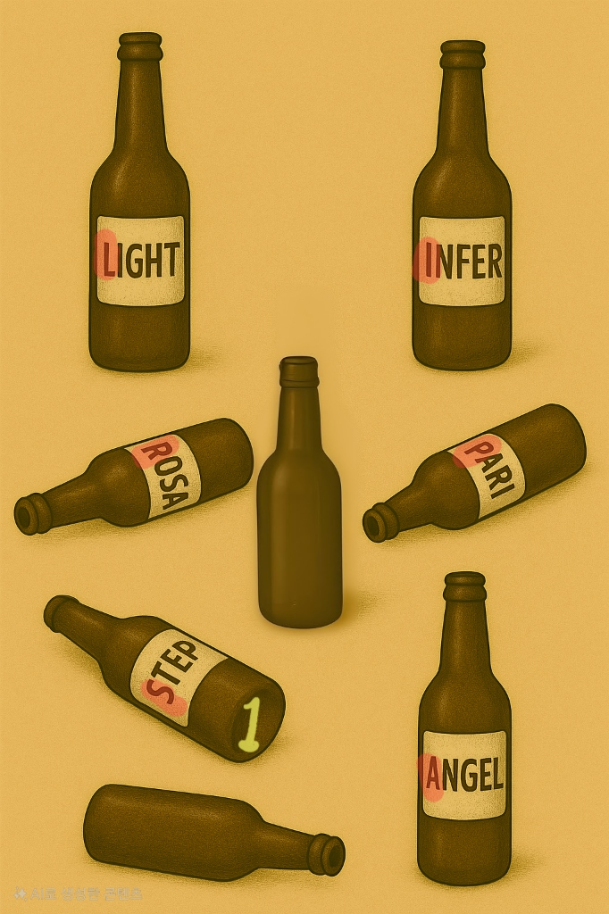
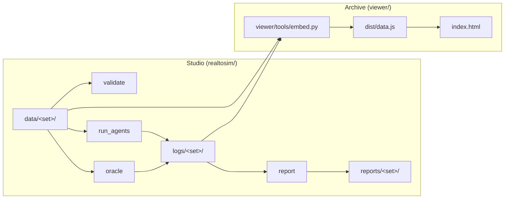

# Real-to-Sim Archive 

**English** | [한국어](README.ko.md)

> A small experiment that applies the robotics real-to-sim idea to a puzzle in a real building.

### Why we built this

In robotics, real-to-sim means bringing a real environment into simulation and testing a behavior there before it runs on real hardware. We wondered whether the same approach could work for a puzzle placed in a space. So we put one floor of a building into a simple floor plan, made one puzzle, and let AI agents with random personas play it.

Every move, answer and reason goes into a log, and the Archive replays it on the map. We wanted to see whether the answer patterns show where a puzzle only makes sense to its maker (the curse of knowledge). We do not claim the agents behave like people statistically.

---

## Quick start

Steps 1–3 and 5 work without an API key or a `.env` file. Only step 4 needs a key.

### 1. Open the Archive viewer (no build needed)

`viewer/dist/` is committed. It opens directly via `file://` without a bundler.

- **Directly in browser (easiest)**: Double-click `viewer/index.html` in your file manager or drag it into any browser. Add `?lang=ko` to the URL for Korean.
- **Via local HTTP server (CLI / remote environments)**:
  ```bash
  python3 -m http.server 8000
  ```
  After starting the server, open `http://localhost:8000/viewer/` in your browser (add `?lang=ko` for Korean).

### 2. Install and run the tests

Tested with Python 3.13.

```bash
python3 -m venv .venv
.venv/bin/pip install -r requirements.txt   # jsonschema, httpx
.venv/bin/python -m unittest discover tests -v
```

### 3. Run the Studio without a key

```bash
.venv/bin/python -m realtosim.validate drunkard-set        # check the puzzle set
.venv/bin/python -m realtosim.oracle drunkard-set          # answer-key run, rewrites logs/drunkard-set/oracle/r0.json
.venv/bin/python -m realtosim.report drunkard-set --no-llm # rebuild reports/drunkard-set/ from the logs
```

### 4. Run new agent episodes (needs a model API key)

Only `realtosim.run_agents` calls the model. Without a key it stops with `MODEL_API_KEY이 없습니다`. `.env` is git-ignored. Never commit the key.

```bash
cp .env.example .env   # then set MODEL_API_KEY in .env
.venv/bin/python -m realtosim.run_agents drunkard-set --start 13 --runs 5   # writes r14–r18
```

`run_agents` never overwrites a log. Without `--start 13` it stops with `덮어쓰기 거부: logs/drunkard-set/r01.json`.

### 5. Rebuild the Archive (after new logs)

> [!IMPORTANT]
> Use **Node 24** (`node -v`). With older Node (for example 12), `tsc` fails with `SyntaxError: Unexpected token '?'`.

```bash
cd viewer && npm ci && cd ..                  # three 0.185.0, typescript 5.9.3, @types/three 0.185.0
.venv/bin/python viewer/tools/embed.py        # logs + data -> viewer/dist/data.js
viewer/node_modules/.bin/tsc -p viewer        # src/*.ts -> viewer/dist/app.js
```

---

## The puzzle

We made one puzzle, `drunkard-set`, and had the personas play it. The player starts at `A1` on the 3rd floor of a building and is told to check a sign at `C4`. There a drunkard talks and shows this picture:



**Question:** Solve the drunkard's game and answer where to go next. (6 letters, 5 attempts, one hint after 2 wrong answers.)

His hint lines include "I drink and feel ashamed, feel ashamed so I drink...", "Did I not tell you already?" and a song that goes "Round and round~". The full data is in `data/drunkard-set/puzzle.json`.

<details>
<summary><b>Solution (spoiler)</b></summary>

The game is a word chain. Start at the bottle marked 1 and link each last letter to the next first letter: STEP → PARI → INFER → ROSA → ANGEL → LIGHT. The red first letters read **SPIRAL**. The answer is the word `SPIRAL`, the name of the next place.

</details>

---

## What the logs showed

13 agent runs, each with a random persona (`age`, `job`, `vocab`, `thinking`). The full numbers are in `reports/drunkard-set/report.md`.

<details>
<summary><b>Details (spoiler)</b></summary>

- 12 of 13 runs solved it. 23 of 24 wrong answers named a staircase or spiral place.
- Most agents found the word SPIRAL but answered with a place, such as "in front of the spiral staircase". `r07` worked out the full chain and still answered this way four times.
- Offline players got stuck earlier, on the chain rule.

We meant SPIRAL as the place name itself. The pattern could be the curse of knowledge in the puzzle, or our language setup below. The logs cannot tell which. You can replay any run in the viewer.

</details>

### Limits and what was hard

- The agents gave similar answers run after run. Persona differences did not show clearly.
- We did not separate Korean and English well. The prompt and question are Korean, but the answer is an English word, checked by exact match. In 16 of 24 wrong answers the agent's `reason` already contained the correct word, but the answer was submitted in Korean.
- We planned to build the floor plan from photos with SAM on Modal, and tested SAM 3.1 access (`test_sam.py`), but ran out of time. The floor plan is hand-written. `test.py` and `test_sam.py` are those Modal experiments. They need packages not in `requirements.txt` and are not part of the pipeline.
- One run took about 10 minutes, and we did not find a way to make it faster.

---

## Studio and Archive

- Studio (`realtosim/`) validates a puzzle set, runs the persona agents, writes logs and builds the report.
- Archive (`viewer/`) is the part of the Studio that replays results: footsteps, the player's ghost, dialogue and answers on a floor map. It is static HTML and works offline from `file://`.



---

## Tech stack

| Part | Stack | Role |
| --- | --- | --- |
| Studio | Python 3 (tested on 3.13), standard library | Engine, validation, agent runs, report |
| Data contracts | JSON Schema draft 2020-12, `jsonschema` 4.26.0 | Validates puzzle, space and log files |
| Agents | Muse Spark (`muse-spark-1.3`), `httpx` 0.28.1 | `/responses` for answers, `/files` for puzzle images |
| Archive viewer | TypeScript 5.9.3, [three.js](https://threejs.org/) 0.185.0 (vendored) | Single `tsc` output, no bundler, opens from `file://` |
| Build and tests | Node 24 (viewer build only), Python `unittest` | |

## Credits

- "Don't Panic" (landing screen) and "So long, and thanks for all the fish" (end of a completed replay and of this README) are short quotes from Douglas Adams, *The Hitchhiker's Guide to the Galaxy*, used as a homage. No other text, cover art or design from the book is used.
- `meta-models/legal-agent-workshop` was used as a reference for ideas (Files API with SHA-256 caching, validation outside the code). No code was copied.
- The puzzle picture (`bottle_quiz.jpg`) was generated with ChatGPT.

## License

This project is licensed under the [MIT License](LICENSE).

---

<div align="center"><i>So long, and thanks for all the fish.</i></div>
