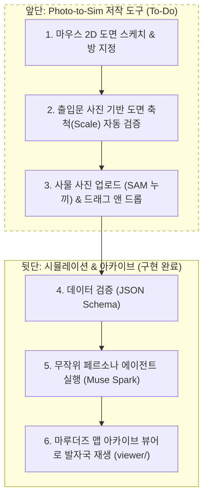

<!-- 2026-11-07 변경 사유: 해커톤 이후 앞단(Photo-to-Sim) 비전, Modal/Muse 기술 설계, 향후 로드맵 문서 신설. 2026-11-07 변경 사유: 기존 입력 계약 정합성 수정 및 뷰어 상대 경로(../viewer/) 정정. -->
# Photo-to-Sim: 마루더즈 맵 스튜디오 비전 및 로드맵

> **"무거운 3D 대신 경량 2D 평면과 마루더즈 맵 감성으로, 누구나 사진과 마우스로 현실 공간을 가상화한다."**

---

## 1. 배경 및 설계 철학

### 왜 3D가 아닌가? (MuJoCo 최적화 철학)
- 시뮬레이션 환경 구축에서 정밀 3D 스캔(NeRF, 3DGS)은 무겁고 노이즈가 많습니다.
- 물리 엔진 MuJoCo가 시각 메쉬 대신 단순 기하 도형(Box, Capsule)으로 충돌 연산을 최적화하듯, 공간 퍼즐 시뮬레이션의 본질은 **'단순화된 평면 위상(방, 벽, 통로, 상호작용 사물)'**입니다.

### 해리포터 '마루더즈 맵(Marauder's Map)' 감성
- 현실 공간을 양피지 질감의 직관적인 2D 평면 지도로 추상화합니다.
- 복잡한 3D 뷰어 대신, 평면 위에서 AI 에이전트들이 발자국(Footprints)을 남기며 단서를 탐색하는 아날로그적이고 친근한 사용자 경험을 제공합니다.

---

## 2. 전체 시스템 파이프라인

---

## 3. 앞단(Photo-to-Sim) 핵심 기술 설계

### 3.1 마우스 2D 도면 스케치 및 방 지정
- 사용자가 웹 캔버스에서 층수를 선택하고 마우스 드래그로 벽과 방 윤곽을 그립니다.
- 전체 공간 중 퍼즐에 활용할 특정 영역만 선택해 방 이름을 입력합니다.

### 3.2 출입문 사진을 활용한 도면 축척(Scale) 자동 검증
단안 카메라 사진은 거리에 따라 픽셀 크기가 달라지므로, 아래 3단계 복합 기법으로 도면의 실제 비율을 맞춥니다.

1. **도면 캔버스 문 도장(Anchor)**:
   - 캔버스에 표준 출입문 기호(폭 0.9m)를 배치하여 도면 기본 축척(`1 그리드 = 0.9m`)을 확정합니다.
2. **SAM 3.1 원근 보정 (Homography)**:
   - 사진 속 문의 4개 모서리를 추출해 표준 방문 종횡비(폭:높이 = 1 : 2.33)로 정면 투영하여 촬영 각도 왜곡을 제거합니다.
3. **Muse Spark VLM 기반 비례 추론 (Relative Ratio)**:
   - 방과 문이 함께 나온 사진을 Muse Spark에 전달합니다.
   - 문 폭(0.9m) 대비 가로 벽체와 주요 가구의 배수(`벽 = 문 × 5.2배`)를 추론합니다.
   - 사용자가 손으로 그린 도면 비율과 비교해 왜곡이 크면 자동 보정 경고를 띄웁니다.

### 3.3 사물 배치 및 실제 사진 연동
- 사용자가 책상, 액자, 술병 등 퍼즐에 쓸 사물 사진을 업로드합니다.
- SAM 3.1이 사물 외곽선을 인식해 배경을 투명화(RGBA Cutout)합니다.
- 투명 아이콘을 도면 위 원하는 위치로 드래그 앤 드롭하여 배치합니다.
- 시뮬레이션 중 에이전트나 플레이어가 해당 사물에 접근하면 실제 촬영 사진이 단서로 팝업됩니다.

---

## 4. 인프라 아키텍처 (Modal + Muse)

| 구성 요소 | 기술 스택 | 역할 |
| :--- | :--- | :--- |
| **Serverless GPU** | Modal (T4, `@modal.web_endpoint`) | SAM 3.1 모델 서빙, 출입문 픽셀 측정, 사물 누끼 자동 추출 |
| **모델 가중치 캐시** | `modal.Volume("sam3-weights")` | 컨테이너 콜드스타트 최소화 (다운로드 시간 0초) |
| **비례/퍼즐 추론** | Muse Spark (`muse-spark-1.3`) | 사진 속 상대 비례 추론, 퍼즐 단서 및 대사 생성 |
| **도면 저작 UI** | Web Canvas / TypeScript | 2D 평면 스케치, 사물 드래그 앤 드롭 팔레트 |
| **시뮬레이션 재생** | Three.js (오프라인 번들) | `viewer/` 마루더즈 맵 발자국 및 고스트 재생 |

---

## 5. 향후 로드맵 및 할 일 (To-Do Checklist)

### Phase 1: Modal 기반 컴퓨터 비전 백엔드
- [ ] `modal_app.py`: SAM 3.1 가중치를 마운트한 Modal 웹 엔드포인트 구축
- [ ] `calibrate_scale` 엔드포인트: 출입문 사진 수신 $\to$ 문 바운딩 박스 및 픽셀 측정 반환
- [ ] `crop_puzzle_object` 엔드포인트: 사물 사진 수신 $\to$ 배경 제거 투명 PNG 반환
- [ ] Muse Spark 프롬프트: 사진 속 '문 너비 대비 벽체/사물 상대 비율' 추론 모듈 작성

### Phase 2: 웹 캔버스 기반 저작 도구 (Studio UI)
- [ ] 2D 그리드 캔버스 드로잉 도구 (벽 그리기, 방 이름 태깅)
- [ ] 표준 출입문(0.9m) 도장 툴 및 축척(Scale) 자동 계산 연동
- [ ] 사물 드래그 앤 드롭 팔레트 및 투명 PNG 에셋 렌더링
- [ ] 도면 결과를 기존 스키마에 맞춰 `data/<set>/space.json`과 `puzzle.json`으로 내보내고, 검증에 필요한 `npc.json`과 `baseline.json` 준비

### Phase 3: 엔드투엔드 파이프라인 통합
- [ ] 웹 저작 도구에서 클릭 한 번으로 `realtosim.validate` $\to$ `run_agents` 호출
- [ ] 생성된 에이전트 로그를 마루더즈 맵 아카이브([viewer/](../viewer/))로 즉시 로딩
- [ ] 사물 인터랙션 시 사용자가 올린 실제 사진 단서 팝업 연동
